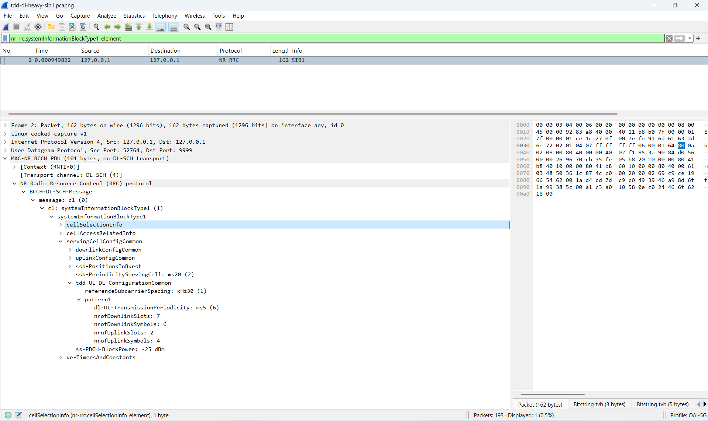
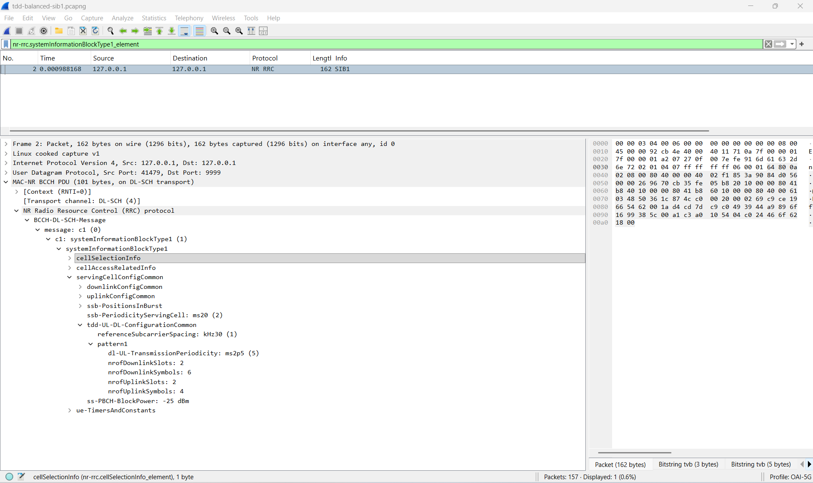
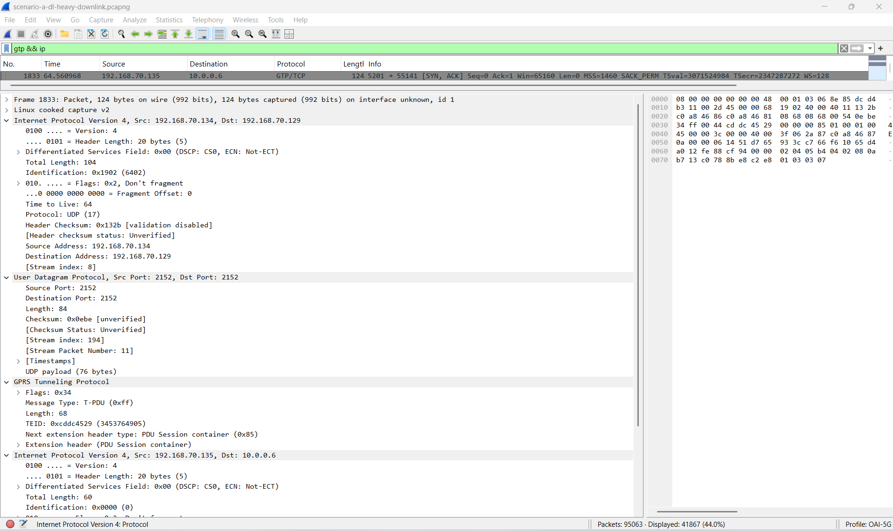
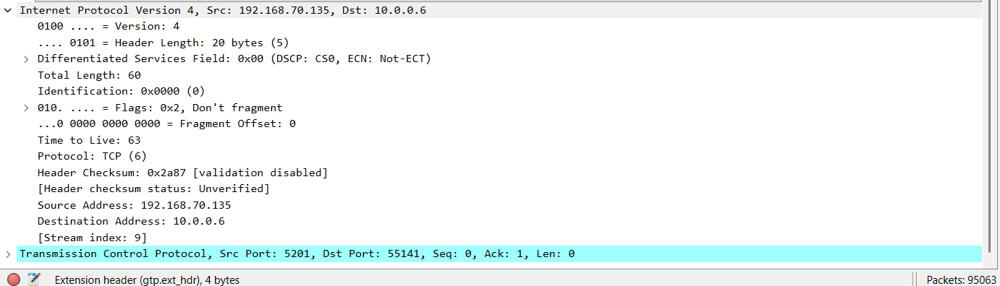
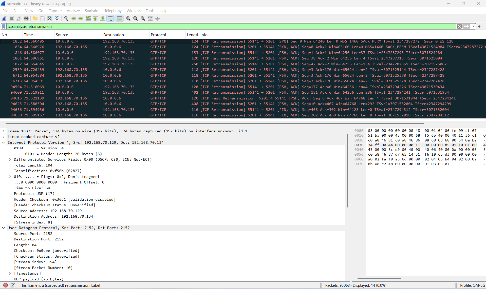
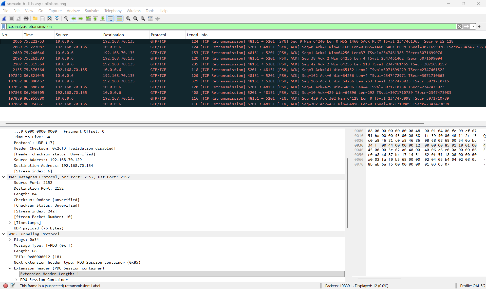

# Lab 2: gNB TDD Traffic Analysis

## Task 1 — Traffic Direction

Source: `start → test_start → reverse` in each iperf3 JSON.

| Scenario | Reverse value | Direction |
|---|---|---|
| A (`scenario-a-downlink.json`) | 1 | Downlink |
| B (`scenario-b-uplink.json`) | 0 | Uplink |
| C (`scenario-c-uplink.json`) | 0 | Uplink |

**Does the JSON direction match the scenario description?** Yes. Scenario A has `"reverse": 1` (downlink), and its intervals show `"sender": false`, so the test machine was the receiver. Scenarios B and C have `"reverse": 0` (uplink), and their intervals show `"sender": true`, so the test machine was the sender. This matches the scenario table (A = downlink, B = uplink, C = uplink).

## Task 2 — Throughput

Throughput (Mbps) = `end → sum → bits_per_second` ÷ 1,000,000.

| Scenario | Direction | bits_per_second | Throughput (Mbps) |
|---|---|---|---|
| A | Downlink | 90,654,195.84 | **90.65** |
| B | Uplink | 109,117,249.69 | **109.12** |
| C | Uplink | 124,416,749.13 | **124.42** |

Improvement (C over B):

(124.417 − 109.117) ÷ 109.117 × 100 = 15.300 ÷ 109.117 × 100 ≈ **14.0 %**

- **Downlink throughput in Scenario A:** about 90.65 Mbps.
- **Uplink throughput in Scenario B:** about 109.12 Mbps.
- **Is uplink higher in B or C?** C is higher.
- **Improvement of C over B:** about 14 %.

## Task 3 — Trade-off (B vs C)

| Scenario | Throughput (Mbps) | Packet loss (%) | Jitter (ms) |
|---|---|---|---|
| B | 109.12 | 0.236 (111 of 47,102 packets) | 0.116 |
| C | 124.42 | 2.134 (1,146 of 53,704 packets) | 0.162 |

- **Does C have higher uplink throughput than B?** Yes, by about 14 %.
- **Does C have lower packet loss than B?** No. C's loss is higher (2.13 % vs 0.24 %, roughly 9 times higher).
- **Trade-off:** Compared with Scenario B, Scenario C has **higher** throughput, **higher** packet loss, and **higher** jitter. These results suggest that the extra uplink capacity in C lets the UE push more data through. The offered UDP load is fixed, so the link is pushed closer to its limit and more packets are dropped and delayed. The gain is therefore not free.

## Task 4 — SIB1 and TDD Configuration

MAC-NR over UDP heuristic dissector (`mac_nr_udp`) enabled; filter `nr-rrc.systemInformationBlockType1_element`.

### 4.3 pattern1 parameters

| Item | DL-heavy: A/B | Balanced: C |
|---|---|---|
| Configuration capture filename | `tdd-dl-heavy-sib1.pcapng` | `tdd-balanced-sib1.pcapng` |
| SIB1 packet number | 2 | 2 |
| referenceSubcarrierSpacing (kHz) | 30 kHz | 30 kHz |
| dl-UL-TransmissionPeriodicity (ms) | 5 ms | 2.5 ms |
| nrofDownlinkSlots | 7 | 2 |
| nrofDownlinkSymbols | 6 | 6 |
| nrofUplinkSlots | 2 | 2 |
| nrofUplinkSymbols | 4 | 4 |
| Is pattern2 present? | No | No |

Screenshots:





### 4.4 TDD time allocation

Legend: `D` = downlink, `U` = uplink, `F` = flexible, `M` = mixed slot (expanded below). `‖` = repeating-period boundary. Each slot is 0.5 ms.

**DL-heavy (A/B): one 5 ms period**

```text
Time (ms) 0    0.5  1.0  1.5  2.0  2.5  3.0  3.5  4.0  4.5  5.0
          ‖    |    |    |    |    |    |    |    |    |    ‖
Slot      | 0  | 1  | 2  | 3  | 4  | 5  | 6  | 7  | 8  | 9  |
Type      |  D |  D |  D |  D |  D |  D |  D |  M |  U |  U |
```

**Balanced (C): 2.5 ms period, repeated twice in 5 ms**

```text
Time (ms) 0    0.5  1.0  1.5  2.0  2.5  3.0  3.5  4.0  4.5  5.0
          ‖    |    |    |    |    ‖    |    |    |    |    ‖
Slot      | 0  | 1  | 2  | 3  | 4  | 0  | 1  | 2  | 3  | 4  |
Type      |  D |  D |  M |  U |  U |  D |  D |  M |  U |  U |
          |<-- period 1 (2.5 ms) -->|<-- period 2 (2.5 ms) -->|
```

**Mixed slot M (symbols 0–13), the same in both configurations**

```text
Symbol  0  1  2  3  4  5  6  7  8  9  10 11 12 13
Type    D  D  D  D  D  D  F  F  F  F  U  U  U  U
```

The mixed slot is slot 7 in DL-heavy and slot 2 in balanced.

At 30 kHz a slot is 0.5 ms and has 14 symbols (0–13). The `‖` marks in the diagrams show the repeating-period boundaries. Slot indices restart at 0 at each period boundary.

- **DL-heavy (5 ms, 10 slots):** slots 0–6 are D. Slot 7 is mixed: symbols 0–5 = D (6), symbols 6–9 = F (4), symbols 10–13 = U (4). Slots 8–9 are U.
- **Balanced (2.5 ms, 5 slots, repeated twice in 5 ms):** slots 0–1 are D. Slot 2 is mixed, with the same layout as above: symbols 0–5 = D, 6–9 = F, 10–13 = U. Slots 3–4 are U.

Symbol layout of the mixed slot (both configurations):

| Symbol | 0 | 1 | 2 | 3 | 4 | 5 | 6 | 7 | 8 | 9 | 10 | 11 | 12 | 13 |
|---|---|---|---|---|---|---|---|---|---|---|---|---|---|---|
| Type | D | D | D | D | D | D | F | F | F | F | U | U | U | U |

**Symbol counts over one repeating sequence**

| TDD setting | Repeating duration (ms) | Total reference slots | DL symbols | UL symbols | Flexible symbols | Configured UL symbol share (%) |
|---|---|---|---|---|---|---|
| DL-heavy | 5 | 10 (140 symbols) | 14×7+6 = 104 | 14×2+4 = 32 | 140−104−32 = 4 | 32/140 = **22.86** |
| Balanced | 2.5 | 5 (70 symbols) | 14×2+6 = 34 | 14×2+4 = 32 | 70−34−32 = 4 | 32/70 = **45.71** |

**Common 5 ms interval**

| TDD setting | Repeating duration (ms) | Repetitions in 5 ms | DL symbols in 5 ms | UL symbols in 5 ms | Flexible symbols in 5 ms |
|---|---|---|---|---|---|
| DL-heavy | 5 | 1 | 104 | 32 | 4 |
| Balanced | 2.5 | 2 | 68 | 64 | 8 |

**Can two patterns have the same UL symbol count per period but different UL symbols per unit time?** Yes. Both patterns have 32 UL symbols per period (2 full UL slots + 4 UL symbols). The DL-heavy period lasts 5 ms and the balanced period lasts 2.5 ms. The balanced pattern therefore repeats twice in 5 ms and gives 64 UL symbols, against 32 for DL-heavy. That is twice the UL resources per unit time (45.7 % vs 22.9 % configured share).

### 4.5 Connecting SIB1 to performance

| Scenario | Reference TDD setting | JSON traffic direction | Configured UL symbol share (%) | Throughput (Mbps) | Packet loss (%) |
|---|---|---|---|---|---|
| A | DL-heavy | Downlink | 22.86 | 90.65 | 0.443 |
| B | DL-heavy | Uplink | 22.86 | 109.12 | 0.236 |
| C | Balanced | Uplink | 45.71 | 124.42 | 2.134 |

- **Which decoded parameters differ?** `dl-UL-TransmissionPeriodicity` (5 ms vs 2.5 ms) and `nrofDownlinkSlots` (7 vs 2). Subcarrier spacing (30 kHz), `nrofDownlinkSymbols` (6), `nrofUplinkSlots` (2) and `nrofUplinkSymbols` (4) are the same.
- **Which provides more configured UL symbols per unit time?** Balanced. It has 64 UL symbols per 5 ms against 32 for DL-heavy, a configured UL share of 45.71 % against 22.86 % (see the diagram).
- **How does that help explain B/C?** C has twice the configured UL opportunities per unit time. This is consistent with its higher uplink throughput (+14 %). The gain is much less than 2×, so throughput does not scale in proportion to UL resources. Scheduling, radio conditions, overhead and offered load also matter. The TDD pattern is not shown to be the only cause.
- **Why can A and B share the same SIB1 TDD configuration?** SIB1 gives the cell's common TDD pattern, which is the same for both DL and UL traffic. The direction of an iperf3 test (`reverse`) only decides which of those resources the traffic uses. The same pattern can therefore serve DL traffic in A and UL traffic in B.

### Optional — PRACH configuration index

| TDD setting | SIB1 packet number | PRACH configuration index |
|---|---|---|
| DL-heavy | 2 | 98 |
| Balanced | 2 | 98 |

The indices are equal. This is a valid observation, and the index is not the DL/UL slot ratio.

## Task 5 — TDD Suitability

| Scenario | TDD setting | Traffic direction | Suitable? Why? |
|---|---|---|---|
| A | DL-heavy | Downlink | Yes. 104 of 140 symbols (74 %) per 5 ms are configured DL, so there are many downlink opportunities. A reached 90.65 Mbps with 0.44 % loss. |
| B | DL-heavy | Uplink | Only partly. Just 32 of 140 symbols (22.9 %) per 5 ms are UL, so uplink opportunities are limited. B still reached 109 Mbps with low loss, but with less headroom than C. |
| C | Balanced | Uplink | Better than B. 64 UL symbols per 5 ms (45.7 %) give twice the uplink opportunities of the DL-heavy setting. Throughput rose to 124.42 Mbps, at the cost of higher loss. |

**Why might C achieve better uplink throughput than B?** From the SIB1 diagrams, the balanced pattern repeats every 2.5 ms and has the same 2 UL slots plus 4 UL symbols in each period. Over 5 ms it has twice as many UL symbols as the 5 ms DL-heavy pattern (64 vs 32). With more uplink transmission opportunities, the UE can send more data per second, which matches the measured 109.12 → 124.42 Mbps. Other factors (scheduling, radio conditions, overhead) may also contribute.

## Task 6 — GTP-U

Capture: `scenario-a-dl-heavy-downlink.pcapng`, packet 1833 (an iperf3 TCP control packet in the tunnel; it contains an inner IPv4 packet). Filter: `gtp && ip`.

| Item | Value |
|---|---|
| Scenario capture filename | `scenario-a-dl-heavy-downlink.pcapng` |
| Packet number | 1833 |
| Outer source IP | 192.168.70.134 |
| Outer destination IP | 192.168.70.129 |
| Inner source IP | 192.168.70.135 |
| Inner destination IP | 10.0.0.6 |
| TEID | 0xcddc4529 |

The outer IPs are the GTP-U tunnel endpoints. The inner IPs are the original UE/application packet: 10.0.0.6 is the UE and 192.168.70.135 is the iperf3 server.




## Task 7 — TCP Retransmissions

Filter: `tcp.analysis.retransmission`

| Scenario | Displayed TCP retransmissions |
|---|---|
| A | 14 |
| B | 12 |
| C | 12 |






**Do these TCP retransmissions directly represent lost UDP performance packets?** No. They affect TCP flows, mostly the small iperf3 control connection (and any other TCP flows in the capture). The UDP test packets are never retransmitted by TCP, and UDP loss is measured separately by iperf3 (`lost_packets`). A retransmission on its own is not proof of loss in the UDP test.

## Task 8 — RTT and Packet Interval

**TCP RTT** (filter `tcp.analysis.ack_rtt`):

| Scenario | Packet number | Example TCP ACK RTT |
|---|---|---|
| A | 1833 (inner TCP 192.168.70.135:5201 → 10.0.0.6:55141) | 0.000485 s (0.485 ms) |

This is the RTT of the iperf3 TCP control connection, not of the UDP data packets.

**Packet interval:**

| Scenario | Display filter | Packet numbers | Time interval |
|---|---|---|---|
| A | `udp.srcport==5201 && udp.dstport==51624 && frame.interface_id==1` | 1896 → 1898 | 0.000081 s (0.081 ms) |

Both packets are on the same capture interface (interface 1). Interface 0 holds loopback duplicates, which are excluded. This interval is not used to infer the TDD pattern.

## Final Questions

1. **Does A use a TDD setting that matches its traffic direction?** Yes. A is a downlink test on the DL-heavy setting, which has 7 full DL slots plus 6 DL symbols, 104 of 140 symbols per 5 ms. It reached 90.65 Mbps with 0.44 % loss.
2. **Why is B expected to have limited uplink resources?** The DL-heavy SIB1 has `nrofUplinkSlots` = 2 and `nrofUplinkSymbols` = 4 in a 5 ms period, 32 of 140 symbols (22.9 %). Most of the period is DL (`nrofDownlinkSlots` = 7).
3. **How much does uplink throughput change from B to C?** It rises from 109.12 to 124.42 Mbps, +15.3 Mbps or about 14.0 %.
4. **What negative result is visible in C?** Packet loss rises from 0.236 % (111 packets) to 2.134 % (1,146 packets). Jitter also rises from 0.116 to 0.162 ms.
5. **Why can more UL resources improve uplink throughput?** More UL slots and symbols per unit time give the UE more opportunities to transmit. Here, balanced has 64 UL symbols per 5 ms against 32.
6. **Is adding more UL resources always best?** No. C gained 14 % throughput but loss rose about 9 times (0.24 % to 2.13 %). Loss-sensitive traffic may prefer B, and the downlink capacity in a balanced setting is lower than in the DL-heavy one (68 vs 104 DL symbols per 5 ms).
7. **A simple follow-up test:** Keep the balanced TDD setting and reduce the iperf3 UDP offered rate (for example with `-b 110M` or `-b 120M`) to find a rate that keeps most of the throughput gain with low loss. Repeating each test several times would also show whether the results are stable.
8. **What can configuration captures tell you that iperf3 JSON cannot?** They show the broadcast TDD parameters in SIB1 (period, DL/UL slot and symbol counts, SCS), which the JSON does not contain. They were recorded separately from the iperf3 runs, so they are only reference recordings of the supplied settings. They are not direct proof of what the cell broadcast during an earlier test.
