# Lab 3: Deploying a 5G Standalone Network Using OpenAirInterface

## Experimental Environment

| Component | Configuration |
|---|---|
| Host | Ubuntu 24.04.5 LTS VM (VirtualBox, 4 vCPU, 3.8 GiB RAM, no swap) |
| OAI RAN | v2.4.0 (`git describe --tags` → `v2.4.0`) |
| 5G Core | OAI CN5G (`~/oai-cn5g`, from `doc/tutorial_resources/oai-cn5g`) |
| gNB / UE | `nr-softmodem` / `nr-uesoftmodem`, built with `./build_oai -I -w SIMU --ninja --gNB --nrUE -C` |
| Radio interface | RFsimulator (TCP port 4043) |
| Band / SCS / PRBs | n78 / 30 kHz / 106 |
| UE IMSI | 001010000000001 |
| External DN | 192.168.70.135 (`oai-ext-dn`) |
| Docker / Compose | 29.9.3 / v5.7.0 |

**Pre-lab checkpoint:** OAI version is v2.4.0, both `nr-softmodem` and `nr-uesoftmodem` exist in `cmake_targets/ran_build/build`, Docker and Docker Compose work, and all 10 CN5G containers start and reach `(healthy)`. The `oai-cn5g` bridge is `192.168.70.129/26`. The subscriber table (`AuthenticationSubscription`) contains IMSIs 001010000000001–004 only, so 001010000000099 is not provisioned.

All measurements below were taken on 2026-11-15 on this VM.

## Task 1 — Deploy and Verify the Complete 5G SA Network

Commands: `docker compose up -d` in `~/oai-cn5g`, then the gNB and nrUE commands from the Build Guide.

| Stage | Successful? | Evidence from logs |
|---|---|---|
| CN5G initialization | Yes | `docker compose ps`: all 10 containers (mysql, nrf, udr, udm, ausf, amf, smf, upf, ext-dn, ims) `Up (healthy)`. AMF: `[amf_app] [start] Options parsed!`, `AMF N1 started`, `Status: REGISTERED` (with NRF). |
| gNB NG Setup | Yes | gNB: `[NGAP] Send NGSetupRequest to AMF` → `[NGAP] Received NGSetupResponse from AMF` → `Received NGAP_REGISTER_GNB_CNF: associated AMF 1`. AMF table: gNB `0x0E00`, `gNB-OAI`, PLMN `001,01`, status `Connected`. |
| UE synchronization | Yes | UE: `Connection to 127.0.0.1:4043 established`, `Initial sync successful, PCI: 0`, `UE synchronized! decoded_frame_rx=162`, `SIB1 decoded`. |
| RRC connection establishment | Yes | UE: `4-Step RA procedure succeeded`, `Received NR_RRCSetup`, `State = NR_RRC_CONNECTED`. gNB: `(UE ID 7 RNTI fb7d) Received RRCSetupComplete (RRC_CONNECTED reached)`. |
| UE Registration | Yes | UE: `FGS_AUTHENTICATION_REQUEST` → `FGS_SECURITY_MODE_COMMAND` → `Received Registration Accept with result 3GPP` → `RegistrationComplete`. AMF table: `001010000000001  5GMM-REGISTERED`. |
| PDU Session Establishment | Yes | UE: `PduSessionEstablishRequest` → `Received PDU Session Establishment Accept, UE IPv4: 10.0.0.2`. gNB: `Added PDU Session 10`, `Added DRB 1`, `PDU Session Setup: ID=10, outgoing TEID=0x88ebaa6e`. SMF: `PDU Session Establishment Request (UE-Initiated)`, `PDU Session Status Active`, `PAA IPv4: 10.0.0.2`, DNN `oai`. |
| UE tunnel creation | Yes | UE: `[OIP] Interface oaitun_ue1 successfully configured, IPv4 10.0.0.2`. `ip -4 addr show oaitun_ue1` → `inet 10.0.0.2/24`. |

Screenshots:

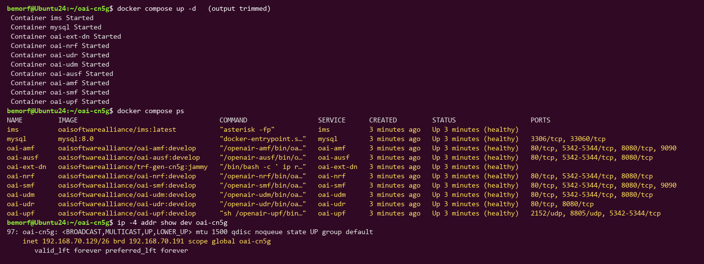

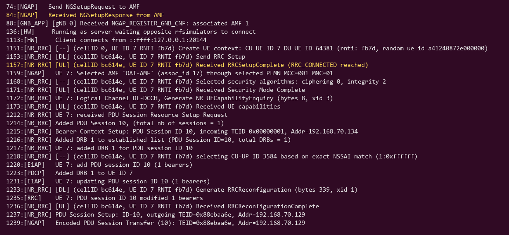

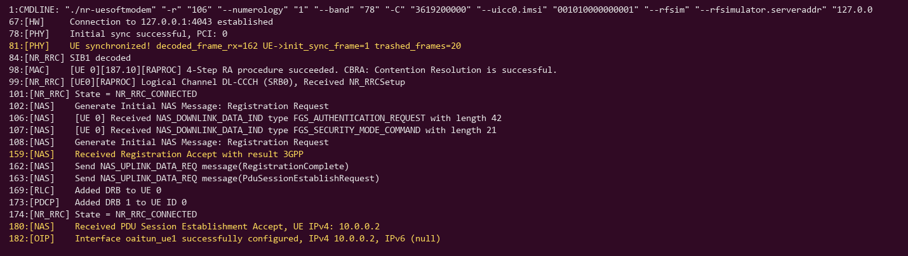

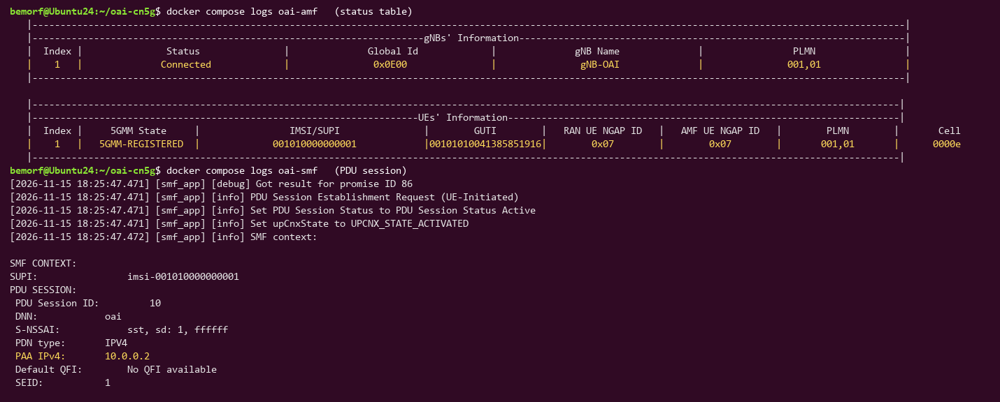

- **Does a successful NG Setup guarantee that a UE can register?** No. NG Setup only proves that the gNB and the AMF have an N2 (SCTP/NGAP) association and agree on PLMN and slice support. Registration is a separate per-UE procedure that also needs AUSF, UDM, UDR and the subscriber database. My own run shows this: NG Setup succeeded, but the first UE attempts were rejected because UDR had not connected to MySQL yet, and later because AUSF replied too slowly. The wrong-IMSI test in Task 5 also has a working NG Setup and a failed registration.
- **Why can the UE establish an RRC connection but still fail Registration?** RRC is an access-stratum procedure between the UE and the gNB only. It needs synchronization, random access and RRC Setup, and the core network is not asked. Registration is a NAS procedure between the UE and the AMF, carried transparently through the RRC connection. It can fail for core-network reasons such as an unknown SUPI, wrong keys, an authentication failure or an unavailable NF, while the radio link stays fine.
- **What additional procedure is required after Registration before user data can be exchanged?** A **PDU Session Establishment**. The SMF allocates the UE IP (10.0.0.2), selects the UPF, and sets up the N3 GTP-U tunnel. The gNB then sets up a DRB with an RRC Reconfiguration. Only then does the UE create `oaitun_ue1` and can user-plane traffic flow.

## Task 2 — Investigate RFsimulator Communication

Commands: `pgrep -a nr-softmodem`, `pgrep -a nr-uesoftmodem`, `sudo ss -tnp | grep 4043`, `sudo ss -ltnp | grep 4043`.

| Item | Observed Value |
|---|---|
| gNB process ID | 109670 (owns the 4043 sockets; `pgrep` also lists 109671 with the same command line) |
| nrUE process ID | 127526 (owns the client socket; `pgrep` also lists 127527) |
| RFsimulator transport protocol | TCP |
| RFsimulator port | 4043 (gNB listens on `*:4043`; UE connects from ephemeral port 45134) |
| TCP connection state | `ESTAB` (plus one `LISTEN` socket on the gNB) |
| Connected process(es) | `nr-uesoftmodem` (127.0.0.1:45134) ↔ `nr-softmodem` (127.0.0.1:4043) |

```text
ESTAB  196473 0  127.0.0.1:45134           127.0.0.1:4043            users:(("nr-uesoftmodem",pid=127526,fd=90))
ESTAB  0      0  [::ffff:127.0.0.1]:4043   [::ffff:127.0.0.1]:45134  users:(("nr-softmodem",pid=109670,fd=95))
LISTEN 0      5  *:4043                    *:*                       users:(("nr-softmodem",pid=109670,fd=93))
```

The gNB is the RFsimulator **server** (`Running as server waiting opposite rfsimulators to connect`), and the UE is the **client** (`Running as client`, `Connection to 127.0.0.1:4043 established`). The large Recv-Q on the UE side (196,473 bytes) shows a continuous stream of IQ samples.

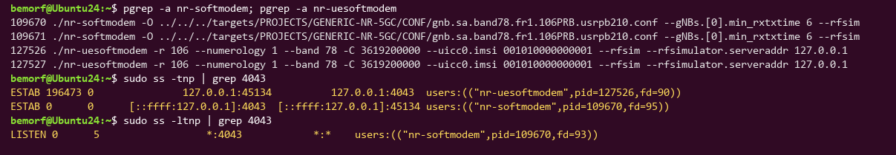

- **Why does RFsimulator use a TCP connection instead of a physical antenna?** No RF front end (USRP) is used. The time-domain IQ samples that would normally go to a DAC and an antenna are written to a socket, and the peer reads them as if they came from its ADC. TCP gives reliable, in-order delivery between two processes on the same host or across hosts. It is simple, needs no hardware, and keeps the sample streams of the two sides aligned.
- **Are the TCP packets exchanged by RFsimulator the same as the UE's application-layer IP packets?** No. The RFsimulator stream carries raw baseband IQ samples of the whole carrier: SSB, PDCCH, PDSCH, PUSCH, reference signals, and also empty slots. The UE's IP packets (for example the pings to 192.168.70.135) are a few layers above. They go through SDAP, PDCP, RLC and MAC, are coded and modulated onto PDSCH/PUSCH, and only then turned into IQ samples. A ping packet is not visible as such on port 4043.
- **Does using RFsimulator mean that the UE and gNB are performing no physical-layer processing? Explain.** No. Only the RF hardware is replaced. Both sides still perform the full NR PHY: OFDM modulation and demodulation (IFFT/FFT), PSS/SSS and PBCH synchronization (`Initial sync successful, PCI: 0`), channel estimation, LDPC/polar coding, HARQ (`DL harq`, `UL harq` statistics) and PRACH (`RA-Msg2 decoded`). The high CPU use of the gNB (~80–125 %) and UE (~50 %) on this VM comes mostly from this PHY processing.

## Task 3 — Verify End-to-End Connectivity

Commands: `ip -4 addr show oaitun_ue1`, `ping -I oaitun_ue1 -c 10 192.168.70.135`.

| Measurement | Observed Value |
|---|---|
| UE IP address | 10.0.0.2/24 (`oaitun_ue1`) |
| Destination IP | 192.168.70.135 |
| Packets transmitted | 10 |
| Packets received | 10 |
| Packet loss (%) | 0 % |
| Minimum RTT (ms) | 154.338 |
| Average RTT (ms) | 252.634 |
| Maximum RTT (ms) | 395.765 |

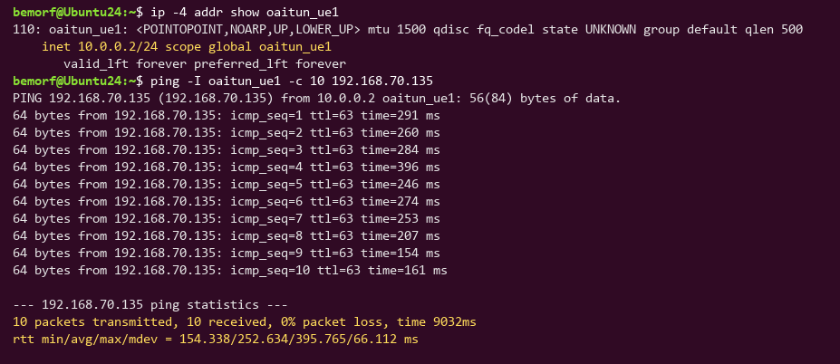

The RTTs are high because the 4-vCPU VM was heavily loaded (load average 20–30) while the gNB, nrUE and 10 containers were all running. After the gNB was restarted later (Task 5), the same 10-ping test gave 41.5 / 67.8 / 82.8 ms (min/avg/max), also with 0 % loss.

- **Why must Ping use the `oaitun_ue1` interface in this experiment?** The UE and the core network run on the same host. Without `-I oaitun_ue1`, the host kernel would route 192.168.70.135 directly over the `oai-cn5g` Docker bridge (192.168.70.129/26), and the 5G system would be bypassed. Binding to `oaitun_ue1` makes the packets use source address 10.0.0.2. They enter the nrUE, cross the simulated radio link to the gNB, travel in GTP-U over N3 to the UPF, and reach the DN. The reply returns the same way.
- **Does successful Registration guarantee successful user-plane connectivity?** No. Registration only gives NAS/control-plane access. User-plane traffic also needs a PDU Session (SMF and UPF selection, an IP address, a PFCP session on N4, a GTP-U tunnel on N3), a DRB, and correct routing in the UPF and the DN. In this lab, after Registration Accept, several restore attempts failed at the PDU session step with `SMF Selection, no SMF candidate is available` (the SMF had stopped responding), so no `oaitun_ue1` was created.
- **What does a successful Ping prove, and what does it not prove?** It proves that the whole chain works end to end: the UE has a valid IP from the SMF, the DRB and the RFsim PHY carry data both ways, GTP-U forwarding between gNB and UPF works, and the UPF routes to and from the DN (TTL 63 shows one routed hop). It does not prove real radio performance: there is no real channel, fading, interference or mobility. It also says nothing about throughput, behaviour under load, QoS, or how many UEs the system can serve. The RTT is dominated by host CPU scheduling, not by 5G air-interface latency.

## Task 4 — Investigate the Effect of Packet Size

Commands: `ping -I oaitun_ue1 -s {56|512|1200} -c 30 -i 0.2 192.168.70.135`, run on the same established connection (UE RNTI fb7d, IP 10.0.0.2), one right after the other.

**Run 1 (required run, same session as Tasks 2–3, VM heavily loaded):**

| Scenario | ICMP Payload | Avg. RTT (ms) | Max. RTT (ms) | Packet Loss (%) |
|---|---|---|---|---|
| A | 56 bytes | 188.959 | 266.943 | 0 % (30/30) |
| B | 512 bytes | 201.662 | 350.693 | 0 % (30/30) |
| C | 1200 bytes | 194.179 | 342.078 | 0 % (30/30) |

RTT Difference = Average RTT(C) − Average RTT(A) = 194.179 − 188.959 = **+5.220 ms** (+2.8 %)

Min RTT / mdev: A 65.941 / 56.724 ms, B 59.192 / 69.229 ms, C 54.919 / 70.115 ms. `pipe 2` appears in all three runs: with 200 ms spacing, some replies took longer than the interval.

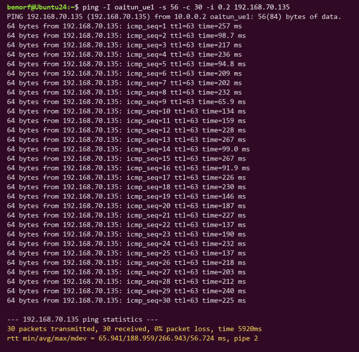

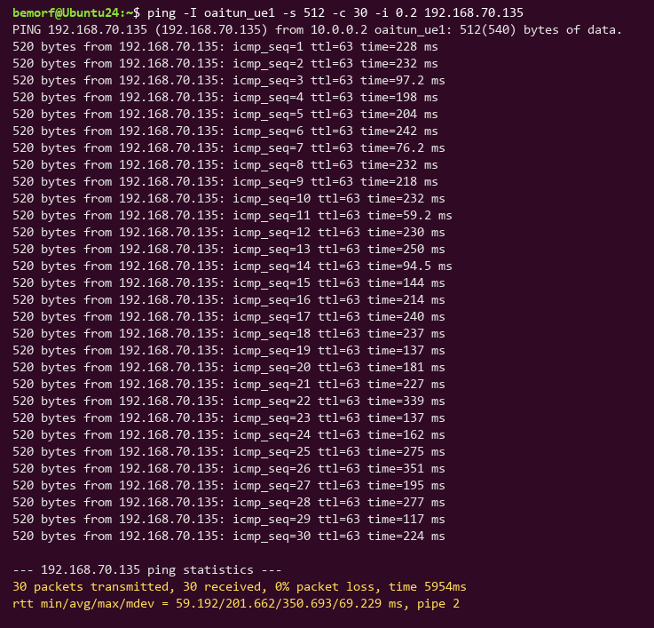

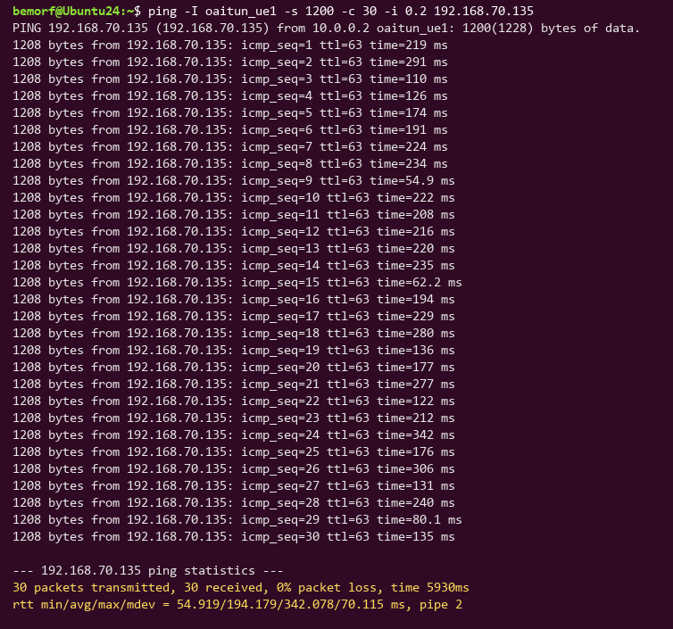

**Run 2 (repeat on the recovered connection after the gNB restart in Task 5, lighter load):**

| Scenario | ICMP Payload | Avg. RTT (ms) | Max. RTT (ms) | Packet Loss (%) |
|---|---|---|---|---|
| A | 56 bytes | 62.674 | 90.063 | 0 % |
| B | 512 bytes | 71.508 | 97.308 | 0 % |
| C | 1200 bytes | 78.393 | 141.124 | 0 % |

RTT Difference (run 2) = 78.393 − 62.674 = **+15.719 ms** (+25 %)

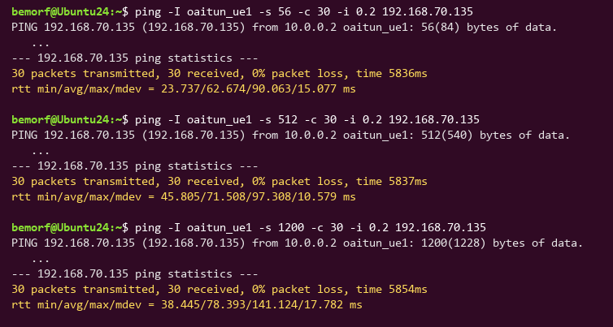

- **Which scenario has the highest average RTT?** In run 1, Scenario **B** (512 B, 201.66 ms), slightly above C (194.18 ms) and A (188.96 ms). In run 2, Scenario **C** (1200 B, 78.39 ms).
- **Does increasing packet size always increase RTT in your measurements?** No. In run 1, B > C > A, so RTT is not monotonic in packet size. The differences (5–13 ms) are much smaller than the jitter (mdev 57–70 ms), so they are not significant. In run 2, with less CPU contention, RTT does rise steadily with size (62.7 → 71.5 → 78.4 ms), and the step is larger than the noise (mdev 11–18 ms). Packet size has a real but small effect, and it only shows up when other delay sources are small.
- **Why might a larger packet require more transmission or processing resources?** A larger packet means a larger transport block. It needs more PRBs or more slots, or the scheduler may segment it over several TTIs at the RLC level. It may need more grant cycles: in uplink the UE must first send a BSR and wait for a larger grant. It also adds more LDPC encoding/decoding, more PDCP/GTP-U copying, and more IQ symbols to modulate and demodulate, all in software on a shared CPU. With 106 PRBs, even 1228 bytes fits in very few slots, so the extra cost is small.
- **What factors other than packet size could affect RTT in a software-based 5G network?** Host CPU load and OS scheduling (load average 20–30 on 4 vCPUs here), VM overhead, competition with Docker containers and their health checks, TDD pattern timing (waiting for the next UL slot), scheduling-request and grant delays, HARQ retransmissions, RFsim TCP buffering (Recv-Q of about 196 KB), the `min_rxtxtime` setting, and processing in the UPF and DN containers. The best evidence is the gNB restart: with the same packet size and the same RF settings, the average RTT dropped from about 189 ms to about 63 ms.
- **Can these results be interpreted as real over-the-air 5G latency? Explain.** No. RFsimulator does not run in real time: the "air" is a TCP socket on localhost, and the speed of the simulation depends on how fast the CPU can produce samples. The measured RTT is mostly host processing and queuing, with no propagation delay, channel impairments or RF front-end latency. A real n78 cell with 30 kHz SCS usually gives a user-plane RTT of about 10–20 ms. My values (55–396 ms) show the limits of this VM, not of 5G NR.

## Task 5 — Diagnose a Controlled UE Registration Failure

The original successful UE command was saved. The nrUE was stopped (SIGINT, the equivalent of Ctrl+C) while CN5G and the gNB kept running. The UE was then restarted with only the IMSI changed:

```bash
sudo ./nr-uesoftmodem -r 106 --numerology 1 --band 78 -C 3619200000 \
  --uicc0.imsi 001010000000099 --rfsim --rfsimulator.serveraddr 127.0.0.1
```

The subscriber database was not modified.

| Item | Observation |
|---|---|
| Modified parameter | `--uicc0.imsi` 001010000000001 → **001010000000099** (Ki/OPc and all other settings unchanged) |
| UE synchronized with gNB? | **Yes.** `Connection to 127.0.0.1:4043 established`, `UE synchronized! decoded_frame_rx=500`, `SIB1 decoded` |
| RRC connection established? | **Yes.** `4-Step RA procedure succeeded`, `State = NR_RRC_CONNECTED`, `Generate Initial NAS Message: Registration Request` |
| Registration successful? | **No.** UE: `Received NAS_DOWNLINK_DATA_IND type FGS_REGISTRATION_REJECT`. No `oaitun_ue1` was created. |
| Error or rejection evidence | UDR: `MySQL Query: SELECT * FROM AuthenticationSubscription WHERE ueid='001010000000099'` → `[error] Authentication Subscription no data`. UDM: `[warning] Invalid request (... cannot use at() with null)`. AUSF: `[error] Resource corresponding to User imsi-001010000000099 not found`, `Send 404 Not_Found`. AMF: `Got UE Authentication from AUSF: {"cause":"CONTEXT_NOT_FOUND",...,"status":404}` → `[error] Request Authentication Vectors failure` → `5GMM state transition: COMM-PROC-INIT -> 5GMM-DEREGISTERED (event: [REGISTRATION_REJECT_SENT])` → `Create Registration Reject and send to UE`. |
| Likely cause | The SUPI `imsi-001010000000099` has no subscription or authentication data in the UDR/MySQL database. The home network cannot generate an authentication vector, so the AMF rejects the registration before authentication even starts. |

The UE log says `Received Registration reject message too short`. The AMF encodes a 4-byte Registration Reject (`Encoded RegistrationReject message len (4)`), which the OAI v2.4.0 nrUE does not fully decode. The 5GMM cause value is therefore not printed on the UE side, and the AMF/AUSF/UDR logs above give the actual reason. During the failure, `ss -tnp` still showed `ESTAB 127.0.0.1:39080 ↔ 127.0.0.1:4043` between `nr-uesoftmodem` and `nr-softmodem`.

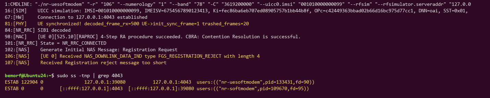

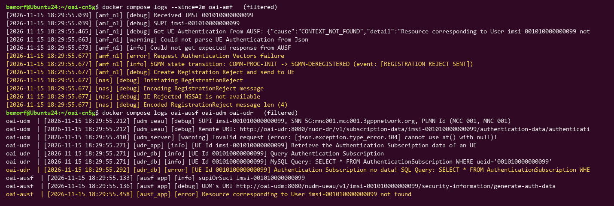

**Restore:** the UE was restarted with `--uicc0.imsi 001010000000001`. It registered again (`Registration Accept`), got `PDU Session Establishment Accept, UE IPv4: 10.0.0.2`, and created `oaitun_ue1`. The AMF now lists `001010000000001 5GMM-REGISTERED` and the failed `001010000000099 5GMM-DEREGISTERED`. Ping: 10/10 received, 0 % loss, RTT 41.487 / 67.777 / 82.808 ms.

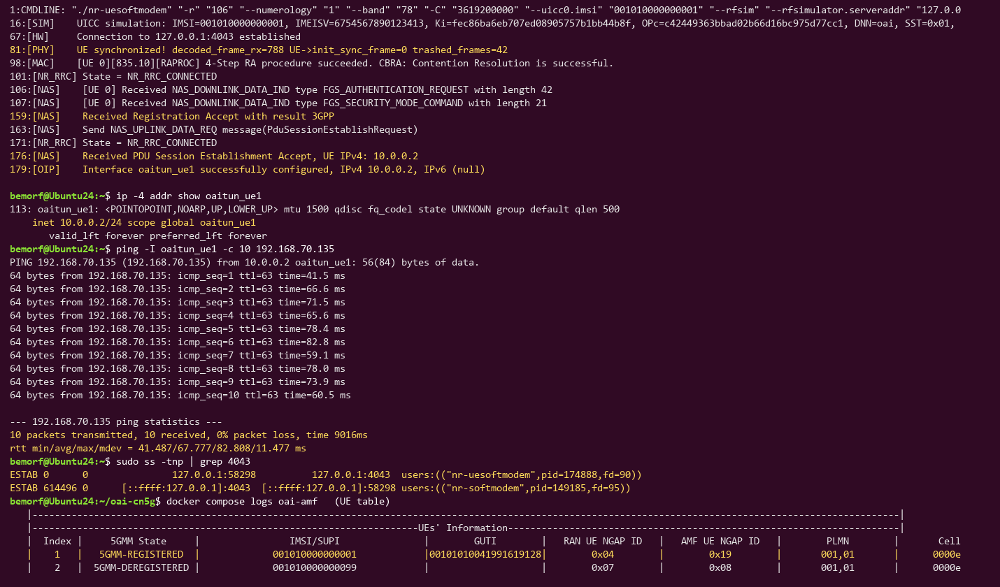

- **Why can the UE potentially synchronize with the gNB even when the IMSI is incorrect?** Synchronization (PSS/SSS, PBCH, SIB1) and random access use only broadcast and cell-level information: frequency, numerology, PCI and PRACH configuration. The UE does not identify itself with its IMSI at these layers. The IMSI (inside the SUCI) is first sent in the NAS Registration Request after RRC Setup, and only the core network checks it.
- **Which network function is involved in UE authentication?** The **AMF/SEAF** starts authentication and checks RES\*. The **AUSF** runs 5G-AKA and verifies the result. The **UDM** (with ARPF/SIDF) generates the authentication vector from the subscriber's K/OPc/SQN, which it reads from the **UDR** (MySQL `AuthenticationSubscription`). Here the chain broke at UDR → UDM → AUSF (404) → AMF.
- **Why does changing an IMSI affect Registration but not the RFsimulator TCP connection itself?** The RFsim TCP connection is a transport for IQ samples between the UE and gNB processes. It is opened before any protocol exchange and knows nothing about subscribers. The IMSI is NAS-layer data carried inside that sample stream and checked only by the 5GC. The TCP connection therefore stayed `ESTAB` while the AMF rejected the UE.
- **What evidence proves that restoring the correct configuration solved the problem?** With only the IMSI changed back, the same gNB/CN5G gave: UE `FGS_AUTHENTICATION_REQUEST` and `FGS_SECURITY_MODE_COMMAND` (authentication was attempted, which never happened for `…099`), then `Received Registration Accept`, `PDU Session Establishment Accept, UE IPv4: 10.0.0.2`, `oaitun_ue1` configured, AMF `001010000000001 5GMM-REGISTERED`, and a ping to 192.168.70.135 with 0 % loss.

## Task 7 — Explain the Relationship Between Simulation and Real 5G

| Feature | OAI RFsimulator | Physical 5G System |
|---|---|---|
| gNB and UE protocol stack | Full NR stack in software: PHY, MAC, RLC, PDCP, SDAP, RRC, NAS. The same code as with a USRP. | Full stack in the gNB (often split CU/DU/RU) and in the UE modem chipset. |
| OFDM signal processing | Yes. IFFT/FFT, CP, sync, channel estimation, LDPC/polar coding are all done in software. | Yes, in DSP/ASIC/FPGA (UE) and in software or accelerators (gNB). |
| Physical antennas | None. IQ samples go over TCP port 4043 on localhost. | Yes. Antenna arrays, often MIMO and beamforming. |
| RF hardware impairments | None by default (no phase noise, IQ imbalance, CFO, PA non-linearity, ADC quantization). Only simple optional channel models. | Present: oscillator drift, CFO, phase noise, PA distortion, thermal noise, AGC. |
| Wireless propagation effects | None by default: ideal channel (RSRP about −44 dB, no fading). Path loss and noise can only be added through optional channel models. | Path loss, shadowing, multipath fading, Doppler, interference, blockage. |
| 5G Core connectivity | Real OAI CN5G (AMF, SMF, UPF, AUSF, UDM, UDR, NRF) over real NGAP/SCTP, GTP-U and SBI HTTP/2. | Real 5GC (commercial or open source) over the same standard interfaces. |

- **Which parts of the 5G system remain functional when physical RF hardware is replaced with RFsimulator?** Everything above the RF front end. The baseband PHY (OFDM, coding, HARQ, PRACH, sync), MAC scheduling, RLC/PDCP/SDAP, RRC and NAS signalling, the NG interface, all core-network functions, authentication and security, PDU sessions and GTP-U forwarding all keep working. Only the DAC/ADC, the RF chain, the antennas and the radio channel are replaced by a TCP socket.
- **Why is RFsimulator useful for testing the 5G protocol stack?** It needs no SDR hardware, spectrum license or shielded room. It is deterministic and repeatable, so failures (like the wrong-IMSI test) can be reproduced exactly. It runs on one laptop or VM and in CI pipelines, and it exercises the real code paths. That makes it a good tool to learn and debug signalling, configuration and core-network behaviour before using real radios.
- **Why might latency and throughput differ between RFsimulator and a real 5G deployment?** RFsim does not run in real time and depends on the CPU. All PHY processing for both ends runs on the same shared vCPUs, and the sample stream goes through kernel TCP buffers. Latency is therefore driven by CPU load (189 ms vs 63 ms average RTT for the same ping before and after the gNB restart), and throughput is limited by how fast the host can process samples. A real system has dedicated hardware and real-time slot timing, but also real channel losses, retransmissions, interference and propagation delay. Both effects make the numbers differ.
- **What would need to change if you wanted to test a physical UE instead of OAI nrUE?** Replace `--rfsim` with a real SDR front end (for example a USRP B210, which the `usrpb210` config is written for) with antennas or cabled attenuators, and run the gNB on a real-time-capable host. Use a frequency the UE supports and that is legally usable (a test license or a shielded box). Program a SIM card (sysmoISIM or similar) with an IMSI, Ki and OPc that match a subscriber in the UDR, and make the PLMN (MCC/MNC), TAC, slice (SST/SD) and DNN in the gNB and CN5G match the phone's configuration.

## Final Analysis

1. **Describe the complete process from starting the OAI 5GC to successful user-plane connectivity.**
   `docker compose up -d` starts MySQL, the NRF and then the NFs (UDR, UDM, AUSF, AMF, SMF, UPF), which register with the NRF. The SMF also sets up a PFCP association with the UPF. The gNB starts, sends an NGSetupRequest to the AMF at 192.168.70.129, receives an NGSetupResponse, and opens its RFsim server on port 4043. The nrUE connects to port 4043, synchronizes (PSS/SSS/PBCH), decodes SIB1, runs 4-step random access, and gets RRC_CONNECTED. Over that RRC connection it sends a NAS Registration Request. The AMF runs 5G-AKA with AUSF/UDM/UDR, followed by NAS Security Mode, and sends Registration Accept. Finally the UE requests a PDU session. The SMF assigns 10.0.0.2 and programs the UPF, the gNB sets up DRB 1 and the GTP-U tunnel, `oaitun_ue1` comes up, and the ping to 192.168.70.135 succeeds.

2. **Explain the difference between an RFsimulator TCP connection and a 5G PDU Session.**
   The RFsim TCP connection (127.0.0.1:ephemeral ↔ 127.0.0.1:4043) is a host-level transport that replaces the radio. It carries raw IQ samples of the whole carrier, opens before any 5G procedure, and has no knowledge of users or IP addresses. A PDU Session is a 3GPP user-plane connection between the UE and a data network (DNN `oai`). The SMF creates it after Registration, and it gives the UE an IP address, QoS flows, a DRB and a GTP-U tunnel through the UPF. The PDU session's packets are carried inside the RFsim sample stream after PHY encoding. As Task 5 showed, the TCP link can be `ESTAB` while no PDU session exists at all.

3. **Based on your measurements, how did packet size affect RTT and packet loss?**
   Packet loss was 0 % in every scenario (180 of 180 pings across both runs), so packet size had no effect on loss. In run 1, under heavy CPU load, the average RTT was 189.0 / 201.7 / 194.2 ms for 56 / 512 / 1200 bytes. That is only +5.2 ms from A to C, non-monotonic, and well within the ±57–70 ms jitter, so there was no significant effect. In run 2, with less load, the average RTT rose steadily, 62.7 → 71.5 → 78.4 ms (+15.7 ms from A to C), which suggests a real but small per-byte processing cost. Overall, host load affected RTT far more than packet size did.

4. **Describe the registration failure you introduced and explain how you diagnosed and recovered from it.**
   I restarted the nrUE with `--uicc0.imsi 001010000000099` and left the gNB and CN5G running. The UE still connected to port 4043, synchronized, completed RA and reached RRC_CONNECTED, but it received `FGS_REGISTRATION_REJECT` and no tunnel was created. In `docker compose logs`, the UDR's MySQL query for `001010000000099` returned "no data", the AUSF returned `404 CONTEXT_NOT_FOUND`, and the AMF logged `Request Authentication Vectors failure` and sent a Registration Reject. The cause is an unprovisioned subscriber. Restoring IMSI 001010000000001 gave authentication, Registration Accept, PDU session 10.0.0.2 and a ping with 0 % loss. A CPU-load-related SMF hang had to be cleared first (SMF and gNB restart, no database change).

5. **Identify two limitations of this simulated environment and explain how they might affect experimental results.**
   First, there is **no real radio channel**: no fading, interference, noise or mobility, with an ideal link at about −44 dB RSRP. BLER, HARQ retransmissions, link adaptation and loss behaviour are therefore unrealistically good, so the 0 % loss here says nothing about real cell-edge performance. Second, **performance is bound to the CPU and not real-time**: the gNB, UE and 10 core containers share 4 vCPUs. RTT (55–396 ms) and even the success of control-plane procedures depend on host load: core-network timeouts caused authentication rejects and an SMF hang during this lab. Latency and throughput results reflect the VM, not 5G NR, and can change from run to run (189 ms → 63 ms average RTT for the same test).
