# Lab 4: 5G CU/DU Split Deployment and F1-C/F1-U Analysis

## Experimental Environment

| Component | Configuration |
|---|---|
| Host | Ubuntu 24.04.5 LTS VM (VirtualBox, 6 vCPU, 3.8 GiB RAM) on an Intel Core Ultra 7 155U laptop |
| OAI RAN | v2.4.0 (`git describe --tags` → `v2.4.0`) |
| 5G Core | OAI CN5G (`~/oai-cn5g`), AMF 192.168.70.132, UPF 192.168.70.134, ext-DN 192.168.70.135 |
| RAN | 1 × gNB-CU (`gnb-cu.sa.f1.conf`) + 1 × gNB-DU (`gnb-du.sa.band78.106prb.rfsim.pci0.conf`) + 1 × nrUE |
| Radio | RFsimulator (TCP 4043), band n78, 106 PRBs, 30 kHz SCS |
| UE | IMSI 001010000000001, `-C 3450720000` |
| Capture | `tcpdump` on `lo` → [lab4-files/lab4-f1-complete.pcap](lab4-files/lab4-f1-complete.pcap); analysed in Wireshark 4.6.8 |
| Extra capture | `tcpdump -i oai-cn5g 'udp port 2152 or sctp'` (N2 + N3), recorded at the same time → [lab4-files/n3-n2.pcap](lab4-files/n3-n2.pcap) |

All measurements below were taken on 2026-11-20 on this VM.

## Task 1 — Inspect the Split Configurations

Both files exist (`gnb-cu.sa.f1.conf`, 1931 bytes; `gnb-du.sa.band78.106prb.rfsim.pci0.conf`, 7491 bytes).

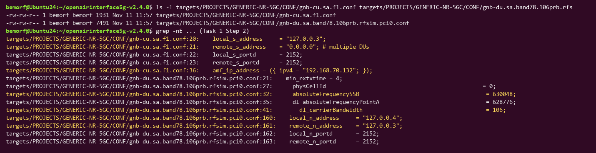

| Parameter | CU (`gnb-cu.sa.f1.conf`) | DU (`gnb-du.sa.band78.106prb.rfsim.pci0.conf`) |
|---|---|---|
| Role | `tr_s_preference = "f1"` (F1 towards the DU) | `tr_n_preference = "f1"` (F1 towards the CU), `tr_s_preference = "local_L1"` |
| F1 address | `local_s_address = 127.0.0.3`, `remote_s_address = 0.0.0.0` (accepts any DU) | `local_n_address = 127.0.0.4`, `remote_n_address = 127.0.0.3` |
| F1-U GTP-U port | `local_s_portd = remote_s_portd = 2152` | `local_n_portd = remote_n_portd = 2152` |
| AMF / N3 | `amf_ip_address = 192.168.70.132`, NG-AMF and NG-U on 192.168.70.129 | — (no core-network interface) |
| `absoluteFrequencySSB` | — | **630048** → 3000 + 0.015 × (630048 − 600000) = **3450.72 MHz** |
| `dl_absoluteFrequencyPointA` | — | 628776 → 3431.64 MHz |
| `dl_carrierBandwidth` | — | **106 PRBs** (centre = 3431.64 + 106 × 12 × 0.03 / 2 = 3450.72 MHz) |
| `physCellId` | — | 0 |
| `min_rxtxtime` | — | 4 |

The local values match the classroom table: CU 127.0.0.3, DU 127.0.0.4, SSB 630048 (3450.72 MHz), 106 PRBs. The DU log confirms the frequency at startup: `absoluteFrequencySSB 630048 corresponds to 3450720000 Hz` and `Command line parameters for OAI UE: -C 3450720000 -r 106 --numerology 1 --band 78 --ssb 516`. Lab 3's monolithic config used SSB 641280 (3619.20 MHz), 168.48 MHz higher.

- **Which protocol layers mainly reside in the CU, and which reside in the DU?** The CU holds the upper layers: RRC and PDCP for the control plane, and SDAP and PDCP for the user plane. It also terminates NG (N2/N3) towards the core. The DU holds RLC, MAC and the high PHY, and the radio (here RFsimulator). This is the 3GPP option-2 split. The logs show it: the CU does NGAP, RRC, PDCP, SDAP, E1AP and GTP-U on N3, while the DU does PHY, MAC, the RFsim server and GTP-U on F1-U.
- **What is the purpose of the F1 interface?** F1 connects a gNB-DU to its gNB-CU so that they act as one logical gNB. F1-C (F1AP over SCTP) carries F1 Setup and cell configuration, RRC messages wrapped in UL/DL RRC Message Transfer, and UE-context management. F1-U (GTP-U over UDP) carries the PDCP PDUs of each DRB between the CU and the DU, plus NR-U flow-control information.
- **Why must the UE radio frequency be compatible with the DU rather than taken blindly from the previous lab?** The DU now owns the PHY and transmits the SSB, so the UE must search where this DU transmits. With Lab 3's `-C 3619200000`, the UE would look 168.48 MHz away from the 3450.72 MHz carrier and never find the SSB or decode SIB1. The value must come from the DU's own `absoluteFrequencySSB` and point A, which the DU log helpfully prints.

## Task 2 — Deploy the Split 5G SA Network

Commands run (CN5G, then CU, then the captures from Task 3, then DU, then nrUE):

```bash
cd ~/oai-cn5g && docker compose up -d && docker compose ps            # all 10 containers (healthy)
sudo ./nr-softmodem -O ../../../targets/PROJECTS/GENERIC-NR-5GC/CONF/gnb-cu.sa.f1.conf
sudo ./nr-softmodem -O ../../../targets/PROJECTS/GENERIC-NR-5GC/CONF/gnb-du.sa.band78.106prb.rfsim.pci0.conf --rfsim
sudo ./nr-uesoftmodem -r 106 --numerology 1 --band 78 -C 3450720000 \
  --uicc0.imsi 001010000000001 --rfsim --rfsimulator.serveraddr 127.0.0.1
```

**gNB-CU:** `Received NGSetupResponse from AMF` → `Starting F1AP at CU` → `F1AP_CU_SCTP_REQ(create socket) for 127.0.0.3` → `Received F1 Setup Request from gNB_DU 3584 (du-rfsim)` → `Accepting DU 3584 (du-rfsim), sending F1 Setup Response`. The CU opens **two** GTP-U instances: `192.168.70.129:2152` (N3) and `127.0.0.3:2152` (F1-U).

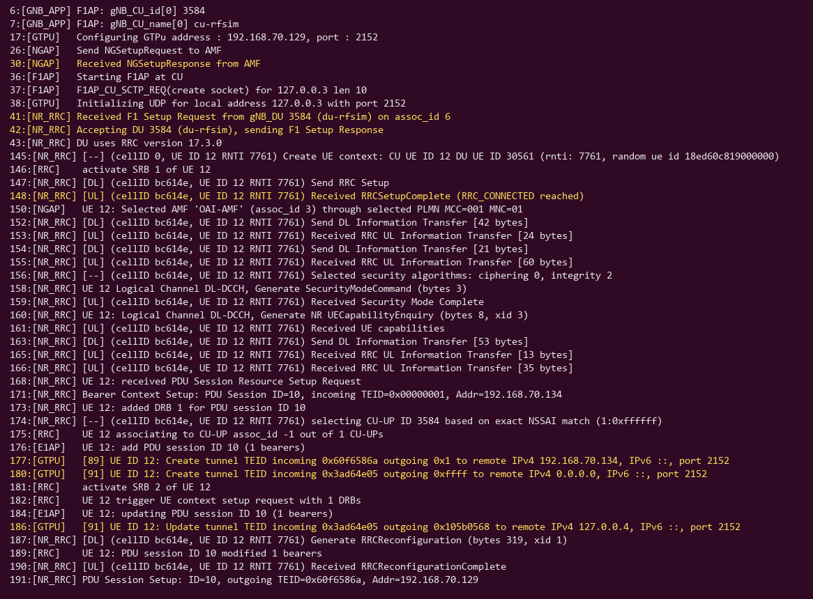

**gNB-DU:** `F1-C DU IPaddr 127.0.0.4, connect to F1-C CU 127.0.0.3, binding GTP to 127.0.0.4` → `received F1 Setup Response from CU cu-rfsim` → `Running as server waiting opposite rfsimulators to connect`.

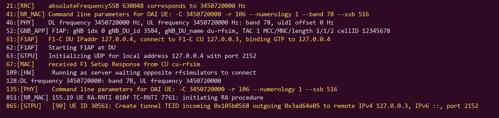

**nrUE:** `Connection to 127.0.0.1:4043 established` → `UE synchronized!` → `SIB1 decoded` → `State = NR_RRC_CONNECTED` → `FGS_AUTHENTICATION_REQUEST` → `FGS_SECURITY_MODE_COMMAND` → `Received Registration Accept` → `PDU Session Establishment Accept, UE IPv4: 10.0.0.2` → `Interface oaitun_ue1 successfully configured`.

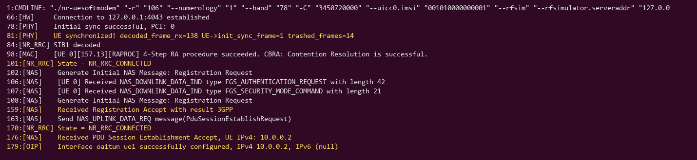

**Connection check** (`ip -4 addr show oaitun_ue1`, `ping -I oaitun_ue1 -c 10 192.168.70.135`):

| Measurement | Observed Value |
|---|---|
| CU process ID | 9020 (`pgrep` also lists 9060) |
| DU process ID | 10022 (`pgrep` also lists 10029) |
| nrUE process ID | 45291 (`pgrep` also lists 45307) |
| UE IP address | 10.0.0.2/24 (`oaitun_ue1`) |
| Packets transmitted / received | 10 / 10 |
| Packet loss | 0 % |
| RTT min / avg / max / mdev | 217.603 / **348.311** / 534.798 / 92.036 ms |

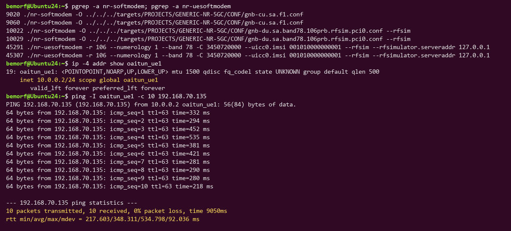

## Task 3 — Capture F1-C and F1-U in a Single PCAP

The capture was started after the CU and before the DU, so the SCTP association and F1 Setup are included:

```bash
sudo tcpdump -i lo -s 0 -nn -w ~/lab4-f1-complete.pcap \
  'host 127.0.0.3 and host 127.0.0.4 and (sctp or udp port 2152)'
```

After the UE tunnel came up, traffic was generated with `ping -I oaitun_ue1 -c 30 -i 0.2 192.168.70.135`: **30/30 received, 0 % loss, RTT 48.243 / 188.504 / 320.692 ms** (min/avg/max). tcpdump was then stopped (`500 packets captured, 0 packets dropped by kernel`) and the file was `66K`.

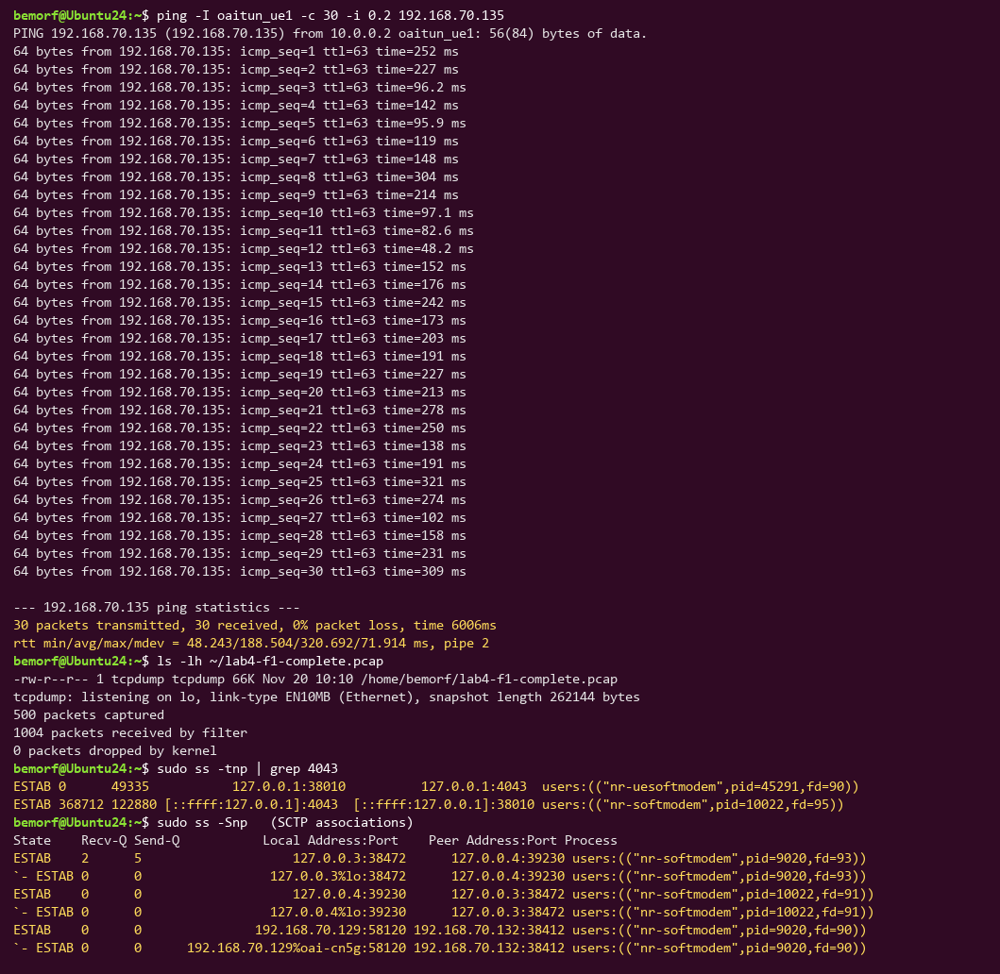

`ss -Snp` shows the two SCTP associations of the CU: **F1-C** `127.0.0.3:38472 ↔ 127.0.0.4:39230` (CU pid 9020 ↔ DU pid 10022) and **N2** `192.168.70.129:58120 → 192.168.70.132:38412` (CU → AMF).

**Protocol hierarchy of `lab4-f1-complete.pcap`** (Wireshark *Statistics → Protocol Hierarchy*):

| Protocol | Frames | Interface |
|---|---|---|
| SCTP | 418 (of which F1AP: 68; the rest are SACK/HEARTBEAT chunks) | F1-C |
| UDP / GTP | 82 | F1-U |
| **Total** | **500** | |

Every packet in the file is between 127.0.0.3 and 127.0.0.4, so all of it is F1 traffic; no N2/N3 traffic is on `lo`.

## Task 4 — Analyze F1-C (F1AP / SCTP)

### SCTP association and F1 Setup

| No. | Time (s) | Source → Destination | Message | Meaning |
|---|---|---|---|---|
| 1 | 0.000000 | 127.0.0.4 → 127.0.0.3 | SCTP INIT | DU opens the association |
| 2 | 0.000094 | 127.0.0.3 → 127.0.0.4 | SCTP INIT_ACK | CU answers with a state cookie |
| 3 | 0.000120 | 127.0.0.4 → 127.0.0.3 | SCTP COOKIE_ECHO | DU returns the cookie |
| 4 | 0.003531 | 127.0.0.3 → 127.0.0.4 | SCTP COOKIE_ACK | Association established (DU port 39230 ↔ CU port 38472) |
| 5 | 0.042203 | 127.0.0.4 → 127.0.0.3 | **F1SetupRequest** (with MIB, SIB1) | DU starts F1 and describes its served cell |
| 7 | 0.064580 | 127.0.0.3 → 127.0.0.4 | **F1SetupResponse** | CU accepts the DU and activates the cell |
| 9 | 0.080538 | 127.0.0.4 → 127.0.0.3 | GNBDUConfigurationUpdate | DU reports configuration changes |
| 10 | 0.114228 | 127.0.0.3 → 127.0.0.4 | GNBDUConfigurationUpdateAcknowledge | CU acknowledges |

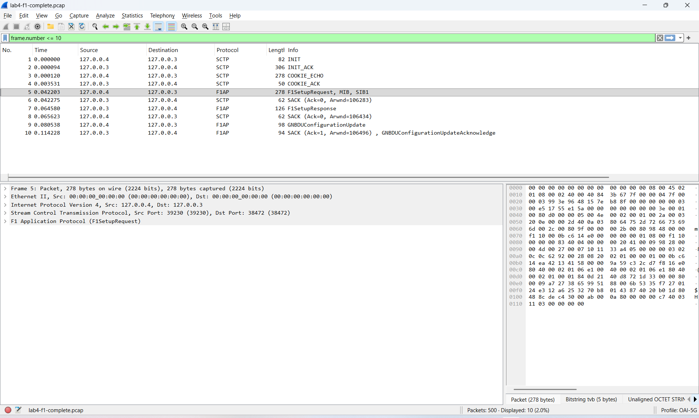

### UE-associated F1AP messages (successful UE, CU UE ID 12 / DU UE ID 30561 / RNTI 0x7761)

| No. | Time (s) | Direction | F1AP message | RRC / NAS content |
|---|---|---|---|---|
| 389 | 2576.963837 | DU → CU | **InitialULRRCMessageTransfer** | RRC Setup Request |
| 390 | 2576.977867 | CU → DU | **DLRRCMessageTransfer** | RRC Setup |
| 391 | 2577.077219 | DU → CU | **ULRRCMessageTransfer** | RRC Setup Complete + NAS **Registration request** |
| 393 | 2577.680554 | CU → DU | DLRRCMessageTransfer | DL Information Transfer: NAS Authentication request |
| 395 | 2577.982592 | DU → CU | ULRRCMessageTransfer | UL Information Transfer: NAS Authentication response |
| 397 | 2578.700613 | CU → DU | DLRRCMessageTransfer | DL Information Transfer: NAS Security mode command |
| 399 | 2578.933351 | DU → CU | ULRRCMessageTransfer | UL Information Transfer (NAS Security mode complete) |
| 401 | 2579.341596 | CU → DU | DLRRCMessageTransfer | RRC Security Mode Command |
| 402 | 2579.539765 | DU → CU | ULRRCMessageTransfer | RRC Security Mode Complete |
| 403 / 405 | 2579.61 / 2579.98 | CU → DU / DU → CU | DL / UL RRCMessageTransfer | UE Capability Enquiry / Information |
| 406 | 2579.989139 | CU → DU | DLRRCMessageTransfer | DL Information Transfer, 53 bytes (NAS Registration Accept*) |
| 408 / 409 | 2580.301041 / 2580.301075 | DU → CU | ULRRCMessageTransfer | UL Information Transfer, 13 and 35 bytes (Registration Complete, PDU Session Establishment Request*) |
| 411 | 2580.735794 | CU → DU | **UEContextSetupRequest** | DRB 1 to set up, UL F1-U tunnel 127.0.0.3 / TEID **0x3ad64e05** |
| 412 | 2580.751186 | DU → CU | **UEContextSetupResponse** | DL F1-U tunnel 127.0.0.4 / TEID **0x105b0568** |
| 413 | 2580.793203 | CU → DU | **DLRRCMessageTransfer** | **RRC Reconfiguration** (adds DRB 1, carries the PDU Session Establishment Accept) |
| 415 | 2581.265502 | DU → CU | ULRRCMessageTransfer | RRC Reconfiguration Complete |
| 416 / 417 | 2581.303542 / 2581.305108 | CU → DU / DU → CU | UEContextModificationRequest / Response | UE context update after reconfiguration |

\* These NAS messages are integrity-protected, so Wireshark shows only "DL/UL Information Transfer". They are identified from the matching sizes in the CU log (`Send DL Information Transfer [53 bytes]`, `Received RRC UL Information Transfer [13 bytes]` and `[35 bytes]`) and the UE log order (`FGS_REGISTRATION_ACCEPT with length 53`, then `RegistrationComplete`, then `PduSessionEstablishRequest`).

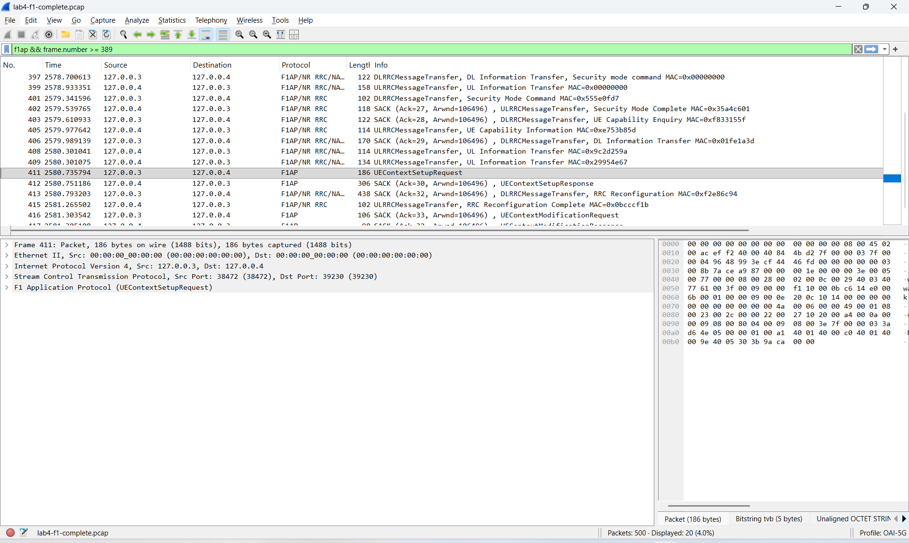

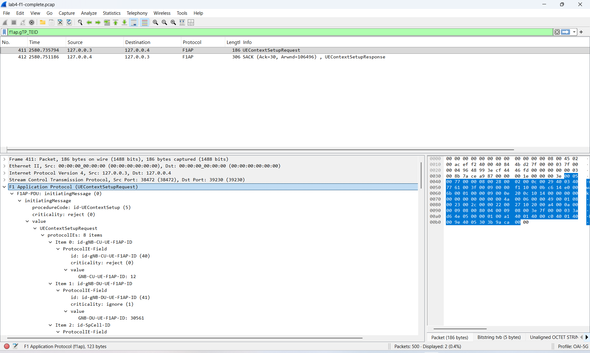

The TEIDs were read from the decoded IEs (`tshark -V -O f1ap`). Frame 411: `uLUPTNLInformation → transportLayerAddress 127.0.0.3, gTP-TEID: 3ad64e05`. Frame 412: `dLUPTNLInformation → transportLayerAddress 127.0.0.4, gTP-TEID: 105b0568`.

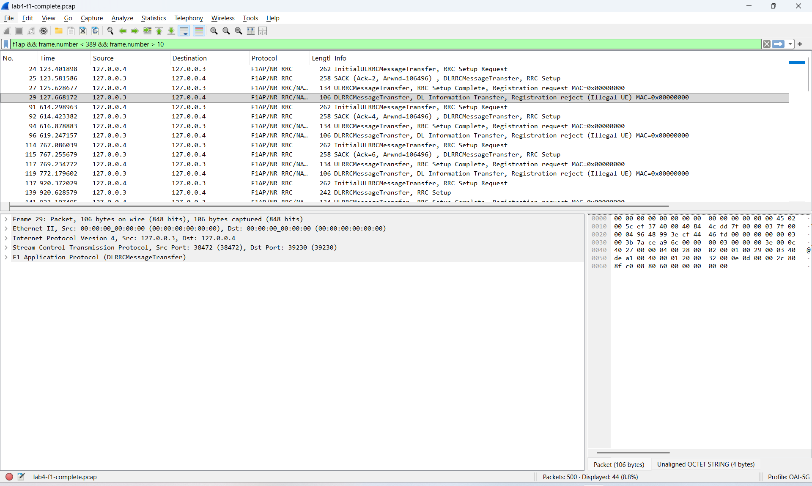

**Questions:**

- **Which node initiates F1 Setup, and which acknowledges it?** The **DU** initiates it: it opens the SCTP association (frame 1, INIT from 127.0.0.4) and sends the F1SetupRequest (frame 5) with its cell information (MIB/SIB1). The **CU** acknowledges it with the F1SetupResponse (frame 7). The CU log shows `Received F1 Setup Request from gNB_DU 3584` and `Accepting DU 3584`.
- **Explain the difference between SCTP association establishment and F1 Setup.** The SCTP 4-way handshake (INIT, INIT_ACK, COOKIE_ECHO, COOKIE_ACK, frames 1–4) only creates a reliable, message-oriented transport connection between two IP endpoints. It knows nothing about 5G. F1 Setup (frames 5 and 7) is the first F1AP procedure, run over that association. The DU identifies itself (gNB-DU ID 3584, name `du-rfsim`) and its served cell (PCI 0, NR cell ID 12345678, PLMN 001/01, TAC 1, MIB/SIB1), and the CU accepts and activates the cell. A DU can have an SCTP association but no working F1 if F1 Setup fails.
- **How can a NAS Registration Request be transported over F1-C?** The UE puts the NAS message inside an RRC message (in `RRCSetupComplete`, the `dedicatedNAS-Message` field). The DU does not interpret RRC. It puts the RRC PDU in the `RRC-Container` of an F1AP **ULRRCMessageTransfer** on SRB1 and sends it to the CU. The CU's RRC extracts the NAS PDU and forwards it to the AMF over N2. Frame 391 shows this nesting: `ULRRCMessageTransfer, RRC Setup Complete, Registration request`. All later NAS messages use the same path (DL/UL Information Transfer).
- **What is the role of UE Context Setup?** It creates the UE-specific context in the DU: the CU tells the DU which SRBs and DRBs to set up (SRB2, DRB 1) and with which QoS. It also exchanges the **F1-U tunnel endpoints** (the CU's UL TEID 0x3ad64e05 in the request, the DU's DL TEID 0x105b0568 in the response). The DU returns its CellGroupConfig (RLC/MAC/PHY configuration), which the CU then sends to the UE in the RRC Reconfiguration (frame 413). Without it, no user-plane data can flow over F1-U.
- **Does F1 Setup alone prove successful UE Registration? Explain.** No. F1 Setup only shows that the DU and CU are connected and the cell is active, before any UE exists. This capture proves it: F1 Setup succeeded at t = 0.06 s, but the next 11 UE attempts all ended with `Registration reject`. Registration needs RRC, NAS, AMF, AUSF and UDM to succeed. User-plane connectivity additionally needs UE Context Setup, a PDU session and F1-U/N3 tunnels. Each stage has to be checked separately.

## Task 5 — Analyze F1-U (GTP-U / UDP)

Display filter `gtp` (82 packets). All are GTP-U **T-PDU (0xff)** messages on **UDP 2152 → 2152** between 127.0.0.3 and 127.0.0.4.

| Direction | Display filter | T-PDUs | TEID | GTP extension header | Notes |
|---|---|---|---|---|---|
| UL: DU → CU (127.0.0.4 → 127.0.0.3) | `gtp && ip.src == 127.0.0.4 && ip.dst == 127.0.0.3` | **43** | **0x3ad64e05** | none | 39 × 87-byte (ICMP echo request) + 4 × 51-byte (the UE's IPv6 Router Solicitations, also seen on N3) |
| DL: CU → DU (127.0.0.3 → 127.0.0.4) | `gtp && ip.src == 127.0.0.3 && ip.dst == 127.0.0.4` | **39** | **0x105b0568** | **NR RAN Container (0x84)**: NR-U DL User Data, NR-U sequence number | 39 × 99-byte (ICMP echo reply) |

The counts are not equal. UL has 4 extra packets (IPv6 Router Solicitations, which get no reply). Both directions also show 39 echo packets, while 40 pings were sent (10 in Task 2 + 30 in Task 3). The capture's last frame (#500) is just before the final echo request of the 30-ping run. On N3 that request arrives 0.26 s later, so tcpdump was stopped before that last request/reply pair reached the F1 file. N3 shows all 40 pairs.

The TEIDs match the F1AP signalling exactly. The UL TEID 0x3ad64e05 was given by the CU in UEContextSetupRequest (frame 411), and the DL TEID 0x105b0568 by the DU in UEContextSetupResponse (frame 412). The OAI logs confirm both: CU `Update tunnel TEID incoming 0x3ad64e05 outgoing 0x105b0568 to remote IPv4 127.0.0.4`, and DU `Create tunnel TEID incoming 0x105b0568 outgoing 0x3ad64e05 to remote IPv4 127.0.0.3`.

**UL T-PDU, frame 422** (DU → CU): IP 127.0.0.4 → 127.0.0.3, UDP 2152 → 2152, Message Type T-PDU (0xff), Length 87, **TEID 0x3ad64e05**. The payload starts with `80 00 03`, a PDCP data PDU header (D/C = 1, SN = 3). It is followed by an IPv4 packet `45 00 00 54 … 0a 00 00 02 c0 a8 46 87`: ICMP echo request 10.0.0.2 → 192.168.70.135. It is readable because DRB ciphering is `nea0`.

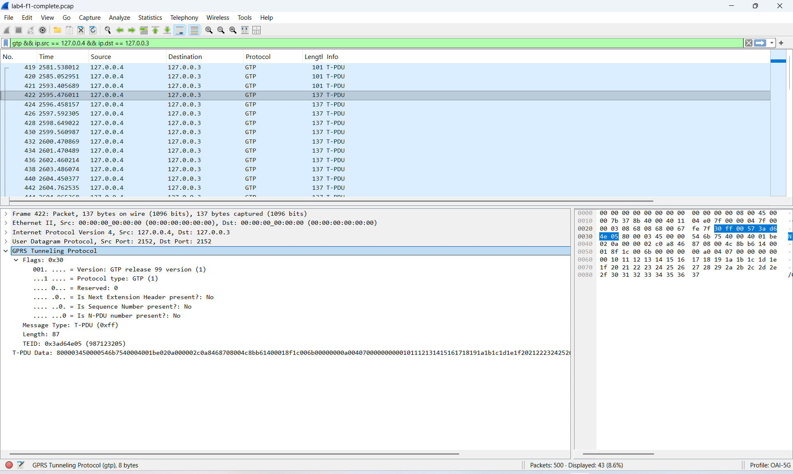

**DL T-PDU, frame 423** (CU → DU): IP 127.0.0.3 → 127.0.0.4, UDP 2152 → 2152, T-PDU, Length 99, **TEID 0x105b0568**, extension header *NR RAN container* (NR-U PDU type *DL User Data*). The PDCP PDU inside carries the echo reply 192.168.70.135 → 10.0.0.2.

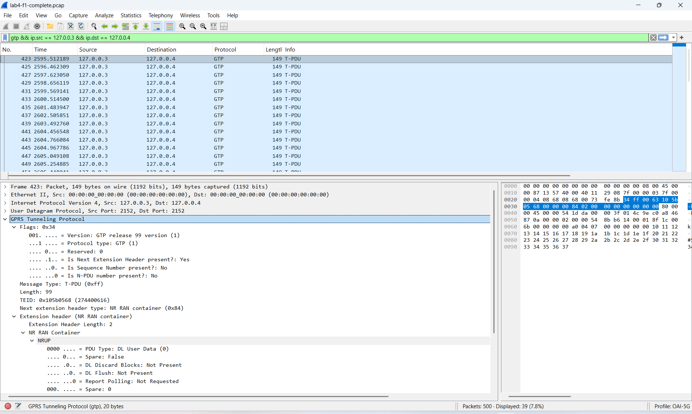

### Distinguishing F1-U from N3

The second capture, on the `oai-cn5g` bridge at the same time, shows the N3 side of the same pings:

| | F1-U (`lab4-f1-complete.pcap`, `lo`) | N3 (`n3-n2.pcap`, `oai-cn5g`) |
|---|---|---|
| Endpoints | DU 127.0.0.4 ↔ CU 127.0.0.3 | CU 192.168.70.129 ↔ UPF 192.168.70.134 |
| Transport | GTP-U / UDP 2152 | GTP-U / UDP 2152 |
| UL TEID | 0x3ad64e05 (CU's F1-U TEID) | 0x00000001 (UPF's N3 TEID) |
| DL TEID | 0x105b0568 (DU's F1-U TEID) | 0x60f6586a (CU's N3 TEID) |
| Extension header | DL: NR RAN Container (0x84, NR-U, TS 38.425) | PDU Session Container (0x85) with **QFI 1** (TS 38.415) |
| Payload | PDCP PDU (PDCP header + IP packet) | Plain IP packet (Wireshark decodes `GTP/ICMP` directly) |
| Set up by | F1AP UE Context Setup | NGAP PDU Session Resource Setup (frames 367/369) + E1 Bearer Context Setup in the CU |

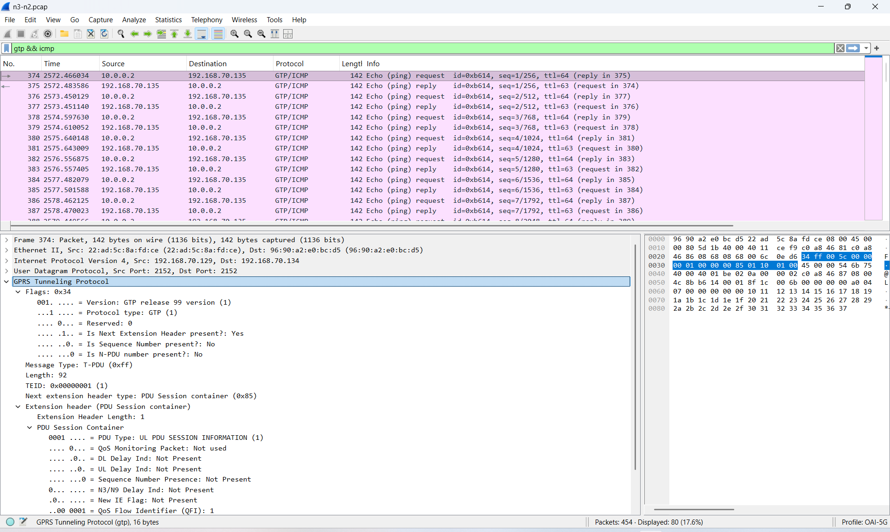

**Questions:**

- **Which transport protocol carries F1-U?** **GTP-U over UDP/IP**, on port 2152 at both ends (127.0.0.4:2152 ↔ 127.0.0.3:2152).
- **What does a GTP-U TEID identify?** A Tunnel Endpoint Identifier identifies the receiving end of one tunnel, which here is one bearer of one UE. The receiver chooses it and tells the sender during signalling. On F1-U there is one tunnel per DRB, so the TEID tells the CU or DU which UE and DRB a PDCP PDU belongs to. Each direction has its own TEID: 0x3ad64e05 is received by the CU, 0x105b0568 by the DU.
- **Which direction is 127.0.0.4 → 127.0.0.3 in this setup?** **Uplink**, from the DU (127.0.0.4) to the CU (127.0.0.3). These 43 T-PDUs carry the UE's data towards the network, such as the echo requests to 192.168.70.135.
- **How would you distinguish F1-U from N3 in a packet capture?** Use the endpoints, not the protocol name: both are "GTP" on UDP 2152. F1-U runs between the DU and CU F1 addresses from the config (127.0.0.4 ↔ 127.0.0.3). N3 runs between the CU's NG-U address and the UPF (192.168.70.129 ↔ 192.168.70.134). Two other signs help. The extension header differs: NR RAN Container (NR-U) on F1-U, PDU Session Container with a QFI on N3. The payload also differs: a PDCP PDU on F1-U, a plain IP packet on N3. Finally, the TEIDs can be matched to their signalling: F1AP UE Context Setup for F1-U, NGAP PDU Session Resource Setup / E1 for N3.
- **Why do F1-C and F1-U use different transport protocols?** They have different requirements. F1-C carries signalling such as F1 Setup, RRC containers and UE contexts. It must be reliable and in order, and SCTP gives that, plus multi-streaming and multi-homing (the same choice as NGAP, XnAP and E1AP). F1-U carries high-volume user data that must have low delay and overhead. GTP-U over UDP adds no retransmission or head-of-line blocking, gives each bearer its own tunnel through the TEID, and leaves reliability to RLC/PDCP and the end-to-end protocols (TCP). Using GTP-U also keeps it in line with N3, S1-U and X2-U.

## Task 6 — Compare Monolithic and Split gNB

| Feature | Lab 3: Monolithic gNB | Lab 4: CU/DU Split |
|---|---|---|
| Number of RAN processes | 1 `nr-softmodem` (+ nrUE) | 2 `nr-softmodem`: CU (pid 9020) and DU (pid 10022) (+ nrUE) |
| Location of RRC/PDCP | Inside the single gNB process | gNB-CU (`cu-rfsim`, 127.0.0.3), with SDAP and the NG interface |
| Location of RLC/MAC/PHY | Inside the single gNB process | gNB-DU (`du-rfsim`, 127.0.0.4), with the RFsim server on 4043 |
| F1-C interface present? | No (internal function calls) | Yes: F1AP over SCTP 127.0.0.4:39230 ↔ 127.0.0.3:38472 (68 F1AP frames captured) |
| F1-U interface present? | No | Yes: GTP-U over UDP 2152, 43 UL + 39 DL T-PDUs (TEIDs 0x3ad64e05 / 0x105b0568) |
| UE connected to the same 5GC? | Yes: AMF 192.168.70.132, SMF/UPF, IMSI 001010000000001, UE IP 10.0.0.2 | Yes: same CN5G, same IMSI, same UE IP 10.0.0.2; only the CU has an N2/N3 connection |
| End-to-end Ping works? | Yes: 10/10, 0 % loss (avg 252.6 ms on 4 vCPU) | Yes: 10/10 and 30/30, 0 % loss (avg 348.3 ms and 188.5 ms on 6 vCPU) |

Other differences: the carrier frequency changed (3619.20 MHz in Lab 3, 3450.72 MHz with `-C 3450720000` in Lab 4). The CU also runs E1AP internally between CU-CP and CU-UP (`E1AP UE 12: add PDU session ID 10`).

**Why the split changes the internal RAN interfaces but not the UE procedures:** The CU/DU split only moves the boundary *inside* the gNB. Functions that used to talk through internal function calls now talk over F1AP/SCTP and GTP-U/UDP. To the UE and to the 5G Core, the CU and DU together still look like one logical gNB. The DU still broadcasts SSB, MIB and SIB1 on the same air interface, and the CU still has one NG-C/NG-U connection to the AMF and UPF. The UE therefore still has to synchronize to the DU's SSB, set up RRC, register and authenticate with the AMF, and establish a PDU session before it gets an IP address. The only visible effect is that the same RRC and NAS messages now also cross F1-C, wrapped in F1AP RRC Message Transfers, and the user data crosses F1-U.
